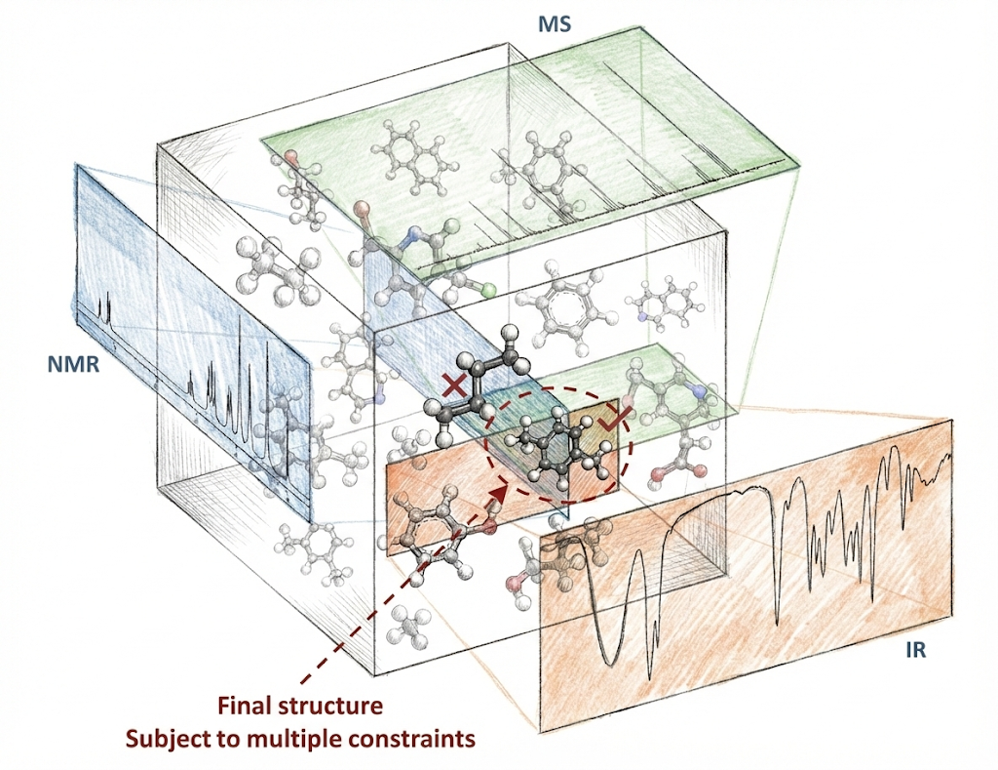
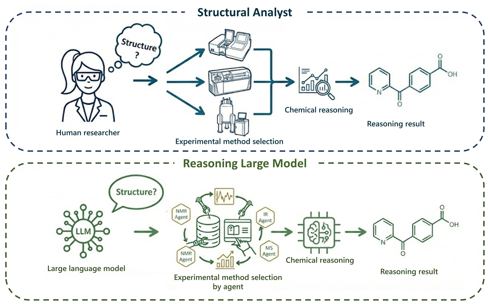
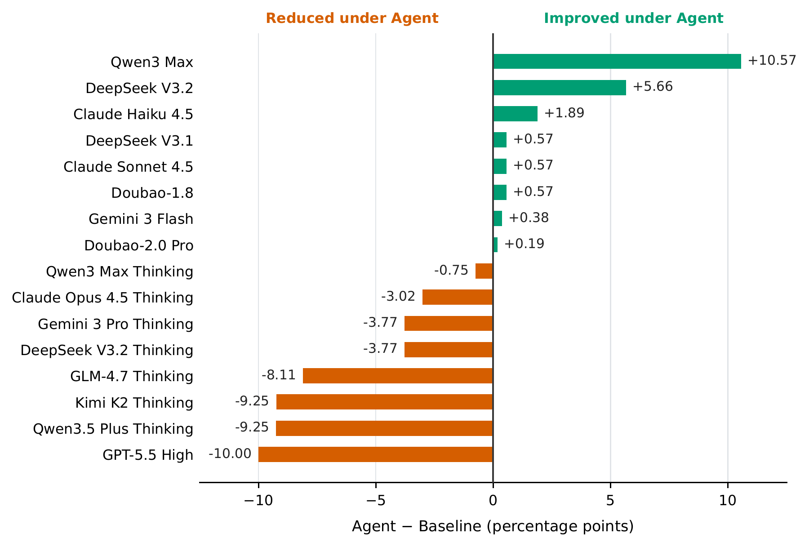
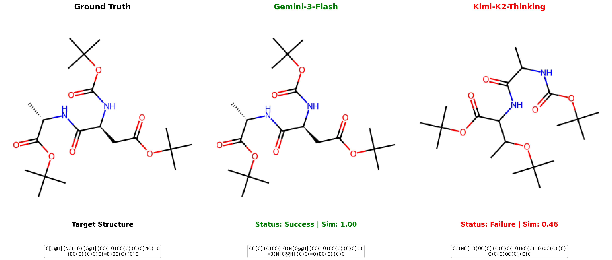

<div align="center">

# MolQuest

### A Benchmark for Agentic Evaluation of Abductive Reasoning in Chemical Structure Elucidation

**530 molecular tasks · 14 laboratory tools · 16 model variants · 32 evaluated configurations**

[Quick start](#quick-start) · [Results](#benchmark-results) · [Benchmark details](docs/benchmark.md) · [Reproduce paper results](paper/README.md) · [Dataset](data/README.md)



</div>

MolQuest evaluates whether language models can identify an unknown organic molecule
by selecting experiments, interpreting the returned evidence, and revising structural
hypotheses. In a simulated laboratory, the agent follows a **Plan → Request → Reason**
loop and submits a SMILES structure with a confidence score. The runtime uses
LangGraph to manage the agent and tool state transitions.

The benchmark uses literature-reported characterization records: NMR peak lists,
MS descriptions, IR absorptions, and physical properties. Tools return stored evidence
on demand. The dataset is intended for evaluation and has no training split.

## How MolQuest works



| Setting | Evidence access | Task |
| --- | --- | --- |
| **Agent** | Request evidence through tools over multiple turns | Choose experiments, update hypotheses, and return a structure |
| **Baseline** | All available evidence supplied upfront | Return a structure in a static evaluation |

Both settings use the same 530 reference molecules. The paper reports structure
accuracy, SMILES validity, Tanimoto similarity, formula conservation, calibration,
and run/trace diagnostics. Each tool call counts as one unit of interaction cost.
See [the benchmark protocol](docs/benchmark.md) for metric denominators and limitations.

## Benchmark results

The table below uses the paper's reconciled **common-530** snapshot. Accuracy is
stereochemistry-aware canonical exact match, expressed as a percentage. Δ is
Agent minus Baseline in percentage points.

<!-- paper-results:start -->
| Model variant | Agent accuracy ↑ | Baseline accuracy ↑ | Δ (pp) |
| --- | ---: | ---: | ---: |
| Gemini 3 Flash | 51.51 | 51.13 | +0.38 |
| Gemini 3 Pro Thinking | 48.30 | 52.08 | -3.77 |
| GPT-5.5 High | 42.64 | 52.64 | -10.00 |
| Claude Opus 4.5 Thinking | 25.47 | 28.49 | -3.02 |
| Doubao-2.0 Pro | 24.91 | 24.72 | +0.19 |
| Qwen3.5 Plus Thinking | 19.25 | 28.49 | -9.25 |
| Claude Sonnet 4.5 | 18.11 | 17.55 | +0.57 |
| Qwen3 Max Thinking | 17.55 | 18.30 | -0.75 |
| Doubao-1.8 | 17.17 | 16.60 | +0.57 |
| DeepSeek V3.2 Thinking | 16.60 | 20.38 | -3.77 |
| Qwen3 Max | 15.28 | 4.72 | +10.57 |
| Claude Haiku 4.5 | 11.51 | 9.62 | +1.89 |
| DeepSeek V3.2 | 11.32 | 5.66 | +5.66 |
| Kimi K2 Thinking | 11.32 | 20.57 | -9.25 |
| GLM-4.7 Thinking | 7.92 | 16.04 | -8.11 |
| DeepSeek V3.1 | 7.36 | 6.79 | +0.57 |
<!-- paper-results:end -->

Gemini 3 Flash has the highest Agent accuracy; GPT-5.5 High has the highest
Baseline accuracy. Interaction helps some configurations and reduces accuracy
for others. This difference reflects the broader interaction protocol, including
evidence ordering and context organization; it does not isolate planning ability.



[Full outcome metrics and integer counts](docs/results.md) ·
[Machine-readable results](paper/data/derived/main_results.csv) ·
[Reconciliation audit](paper/DATA_AUDIT.md)

## Quick start

Requires Python 3.12+ and [uv](https://docs.astral.sh/uv/).

```bash
git clone https://github.com/jiaodu1307/molquest.git
cd molquest
uv sync
cp .env.example .env
```

Set `LLM_API_KEY` and, when needed, `LLM_BASE_URL` in `.env`. In
[`config/settings.yaml`](config/settings.yaml), set `llm.model_name` to an ID
supported by your provider. The adapter uses an OpenAI-compatible API. Reasoning,
streaming, and seed options depend on the selected endpoint.

Run one real sample from the published dataset:

```bash
uv run python main.py --sample 5ef16ca8-fc38-4a6d-9b60-fb155390285c
```

Run a small batch, then resume a larger run:

```bash
uv run python scripts/batch_run.py --max-samples 3 --concurrency 1
uv run python scripts/batch_run.py --resume --concurrency 1
```

These commands make model API calls. Run artifacts are saved under `runs/` and
`traces/`. To inspect evidence without calling a model:

```bash
uv run python -c "from src.utils.molecule_manager import MoleculeManager; print(len(MoleculeManager().get_all_molecules()))"
# 530
```

The current runtime entry points execute Agent mode. The committed paper snapshot
contains both Agent and Baseline predictions and supports reproducing their
aggregate metrics without new model calls.

## Dataset and curation


The paper describes automated extraction from Supporting Information followed
by molecular verification and expert review. Every task includes molecular
formula, molecular weight, and ¹H NMR; 513 include ¹³C NMR, 414 include HRMS,
and 84 include IR. Reference structures and identifiers are evaluation labels;
model-facing tools expose the corresponding experimental fields.

- [Final dataset](data/molecules_final.json): 530 tasks used by the paper.
- [Source records, checksums, and preparation notes](data/README.md).
- [Historical v3 snapshot](data/versions/molecules_v3_535.json): 535 records;
  use only when explicitly evaluating that version.

The released preparation utilities cover the available conversion, deduplication,
validation, and analysis steps. They do not reconstruct the full human curation
workflow or its historical selections. Source-data redistribution licenses and
some provenance details remain undocumented; see the dataset notes.

## Case study



This paper illustration contrasts a matching prediction and a chemically plausible
alternative. It is one example, rather than a measure of average model behavior.
[Inspect the case and its supporting files](case_studies/04dbc4ee/README.md).

## Reproducibility

The compact [`paper/`](paper/README.md) bundle includes per-case predictions,
model names, a fixed metric protocol, derived CSVs, source hashes, and the paper's
figures. Recompute its aggregate metrics and LaTeX tables without API access:

```bash
uv run python paper/scripts/compute_metrics.py
uv run python paper/scripts/generate_tables.py
uv run python paper/scripts/verify_artifacts.py
uv run python paper/scripts/sync_github_results.py --check
```

The verifier checks snapshot and artifact hashes, configuration coverage, and
agreement with the released dataset. GitHub Actions runs these checks for changes
to the paper bundle and documentation. See [paper/README.md](paper/README.md) for
figure regeneration and the distinction between saved outcomes and live runs.

## Repository map

| Path | Contents |
| --- | --- |
| `src/agent/`, `src/core/` | Agent state machine, model adapters and tool registry |
| `src/tools/` | 14 simulated laboratory tools |
| `config/` | Runtime model configuration and prompts |
| `data/` | Final dataset, source snapshots and version history |
| `scripts/data/` | Data preparation and diversity analysis |
| `scripts/analyze/` | Run merging, evaluation and plotting utilities |
| `paper/` | Fixed paper-result snapshot and reproduction pipeline |
| `docs/`, `case_studies/` | Benchmark explanation, figures and worked example |
| `results/` | Existing model results and evaluation artifacts |

## License

The code is released under the [MIT License](LICENSE). This does not establish
redistribution rights for third-party literature-derived data; see
[data/README.md](data/README.md).
