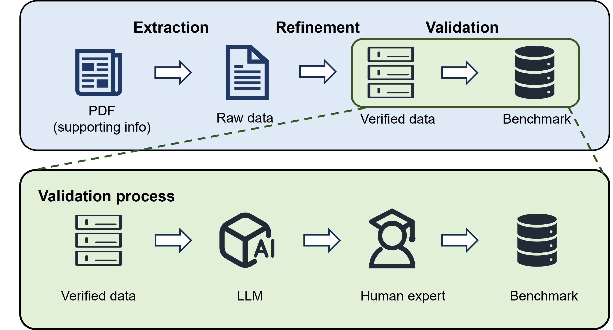
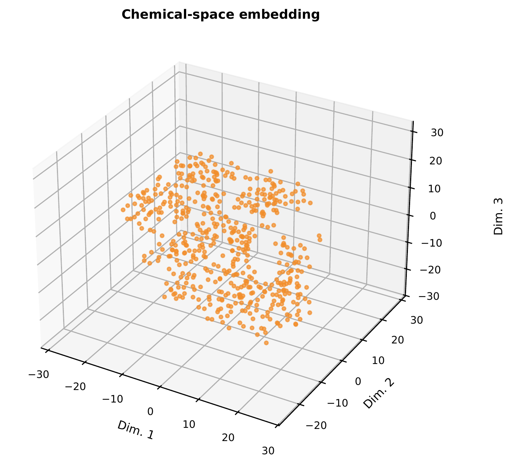
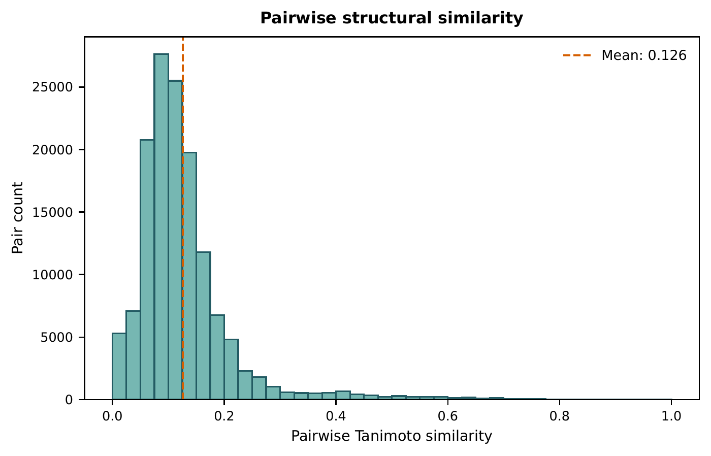

# MolQuest benchmark protocol

[Back to the repository](../README.md) · [Full results](results.md) · [Reproduction bundle](../paper/README.md)

## Task and evidence

MolQuest casts molecular structure elucidation as abductive reasoning under
chemical constraints. The model identifies a molecule consistent with the evidence,
requests more information when useful, and returns one SMILES candidate with a
confidence score. The environment retrieves reported characterization records;
it does not operate instruments or generate new experimental measurements.

The fixed evaluation universe has 530 molecules. It contains peak-list and
characterization text, rather than free-induction-decay files or digitized spectra.
Missing modalities remain missing. The manuscript describes expert review of all
530 records, targeting literature from 2025–2026, with organometallic complexes
and polymers excluded. These are manuscript descriptions of curation; the public
utilities implement only the preparation stages available in the source archive.

| Evidence | Available cases |
| --- | ---: |
| Molecular formula / molecular weight | 530 / 530 |
| ¹H NMR | 530 / 530 |
| ¹³C NMR | 513 / 530 |
| HRMS | 414 / 530 |
| IR | 84 / 530 |

The environment retains reference SMILES and molecular identifiers for evaluation.
Tool responses provide experimental data or derived scalar properties; the model
is not given the original Supporting Information document. `Calculate_DBE` derives
unsaturation internally from the stored reference using RDKit.

## Tool library

Every tool accepts a sample UUID.

| Tool | Returned evidence |
| --- | --- |
| `Check_Data` | Available evidence types |
| `Measure_MW` | Molecular weight in Da |
| `Measure_Formula` | Curated molecular formula |
| `Calculate_DBE` | Degree of unsaturation |
| `Get_1H_NMR` | Proton shifts, multiplicities, integrations and couplings when reported |
| `Get_13C_NMR` | Carbon shifts and acquisition metadata when reported |
| `Get_19F_NMR`, `Get_31P_NMR` | Fluorine / phosphorus NMR descriptions |
| `Get_IR` | Reported absorption text |
| `Get_HRMS`, `Get_MS` | Mass-spectrometry descriptions |
| `Get_Melting_Point` | Value or range |
| `Get_TLC` | Rf and eluent description |
| `Get_Optical_Rotation` | Rotation and reported measurement conditions |

## Two evaluation settings

In Agent mode, a language model requests evidence and refines hypotheses over
multiple turns before submitting its answer. The prompt encourages economical
tool use; one call counts as one interaction-cost unit. In Baseline mode, all
available evidence is provided together. The paper uses temperature zero and
reports 16 model variants in both settings, for 32 configurations.

A model's decision to stop, its evidence ordering, and its context organization
all affect the comparison. Tool-call counts are a proxy for efficiency; they do
not represent actual monetary cost, material use, or instrument time.

## Fixed outcome metrics

The executable protocol is [`metric_protocol.json`](../paper/config/metric_protocol.json).
All displayed result values are scaled to 0–100.

| Metric | Definition | Denominator |
| --- | --- | --- |
| Accuracy | RDKit canonical exact match, including stereochemistry | All 530 predictions |
| Stereo-agnostic accuracy | Exact match after removing atom/bond stereochemistry | All 530 predictions |
| Validity | SMILES parseable by RDKit | All 530 predictions |
| Similarity | Mean radius-2 Morgan Tanimoto similarity, including exact matches | Valid predictions |
| Formula conservation | Predicted formula agrees with reference | Valid predictions |
| RMSCE | Calibration against Tanimoto similarity, 10 equal-width confidence bins | All 530 predictions; invalid SMILES receive similarity zero |

RMSCE is lower when confidence tracks structural similarity more closely. It is
not calibration against binary exact-match accuracy. Confidence zero belongs to
the first bin. Run-level and trace-level diagnostics are included separately in
[`paper/data/derived/`](../paper/data/derived/).

## Dataset diversity

The paper uses radius-2, 2048-bit Morgan fingerprints for pairwise Tanimoto
analysis and a 3D t-SNE visualization with random seed 42.

## Interpretation and limits

The reference is the literature-reported structure. In some cases, the released
evidence may admit several constitutional or stereochemical candidates; the
stereo-agnostic score only partly addresses this ambiguity. Outcome and trace
metrics do not directly establish the quality of intermediate hypotheses or
whether an experiment choice was globally optimal. Results are specific to the
reported model configurations and this small-organic-molecule evaluation set.

The current manuscript reconciles earlier tables to the common 530-case universe.
Use the [audit](../paper/DATA_AUDIT.md) to understand corrections to historical
535-case results and differing prediction collections. The public paper bundle
is pinned to Overleaf commit `c99d3f0939ef16ae987a20bb709edb3f1a75433f`.
